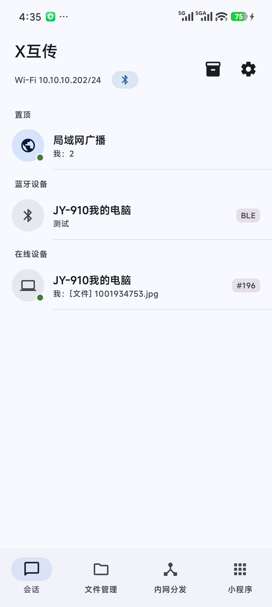
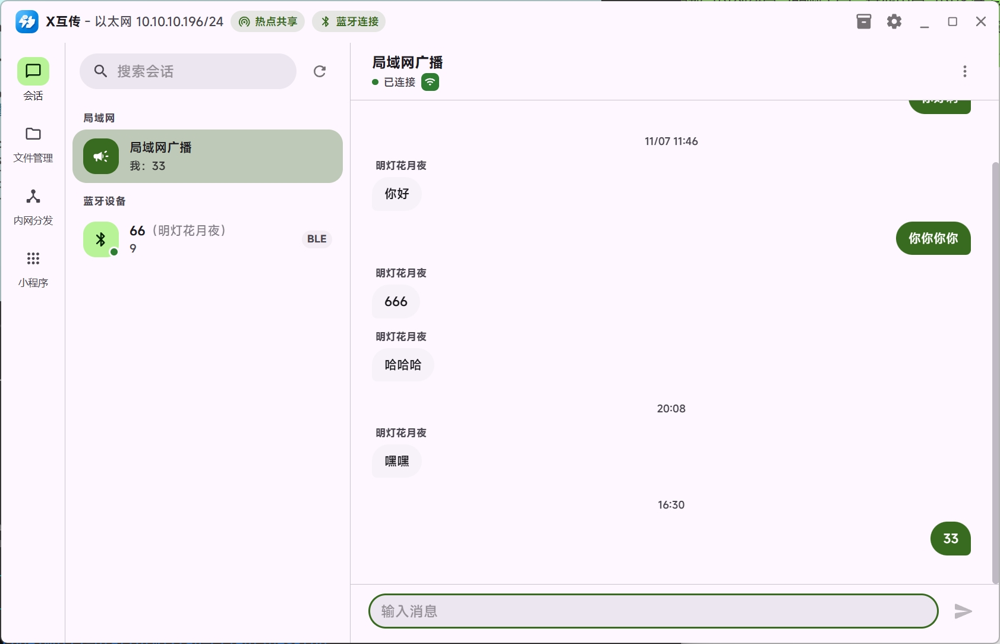
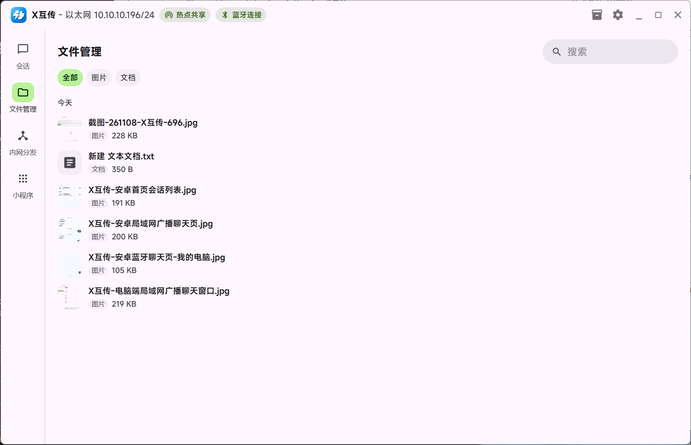
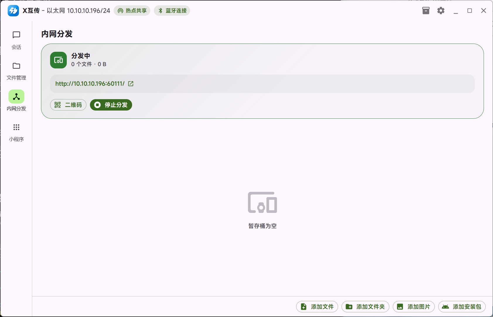

# X互传

局域网与公网之间的点对点互传工具。同一 Wi-Fi 下自动发现设备，文字、文件、文件夹直接传到对方；不在同一网络时，也可以通过自建的中继服务器聊天和传文件。不经过第三方服务器，也不需要注册账号。

当前版本：**0.2.0Beta（测试版）**

## 功能

- **局域网互传**：Windows、Android、Linux、macOS 在同一网段自动发现，支持文字、文件、文件夹，实时进度、取消与重试。
- **公网聊天**：不在同一个网络时，经自建中继服务器连接，支持文字、文件与公共聊天室；中继地址可随时查看和切换。
- **局域网广播**：固定的公共会话，同一网络内的设备都能看到并回复文字消息。
- **蓝牙连接**：通过 BLE 发现附近的 Android 手机或 Windows 电脑，没有局域网时也能互发文字消息。
- **内网分发**：在电脑或手机上开一个网页，同一网络的其他人用浏览器打开即可预览、下载文件；支持二维码、响应式页面与深色模式。
- **暂存桶**：先把要发送的内容攒起来，再选会话一次性发出；支持拖拽、系统分享、相册与安装包选择。
- **文件管理**：查看收到的图片、视频、文档与安装包，支持预览、打开、另存、删除。
- **公网文件按需下载**：聊天里的文件点开才下载，超过 2MB 的图片和可执行文件会先确认再查看。
- **失败重试**：发送失败的文件与消息旁边显示感叹号，点开可以查看原因并直接重试。
- **可信设备**：默认 TLS 加密，可设置自动接收文件，首次连接后不必再重复确认。
- **通知与状态**：新消息、待接收文件、传输完成都有系统通知；会话支持置顶、静音、别名与未读计数。
- **深色模式**：所有客户端均跟随系统或手动切换，桌面端使用 MiSans 字体。

### 桌面端

- 自绘标题栏、会话列表与对话区，关闭窗口可缩进托盘。
- 热点共享、蓝牙连接入口，速度测试、网络自检与缓存清理。
- 内置截图工具，截图后可直接发送。
- 开机自启，接收目录可自定义。
- Windows 提供便携版；Linux、macOS 提供压缩包，解压即可运行。

### Android 端

- 前台服务保持后台收发，划掉应用仍能接收消息。
- 支持系统「分享到 X互传」与 Wi-Fi Direct 直连。
- 收到的文件保存到 `Download/X互传`。
- 图片、视频、APK 与常见文档均可预览。

## 截图

### Android

<p>
  
  
  
</p>

### Windows







## 公网聊天中继

公网聊天需要一台中继服务器，部署步骤见 [公网聊天中继部署](docs/%E5%85%AC%E7%BD%91%E8%81%8A%E5%A4%A9%E4%B8%AD%E7%BB%A7%E9%83%A8%E7%BD%B2.md)。

## 技术栈

| 部分 | 技术 |
|---|---|
| 桌面客户端 | Electron 45、React 19、MUI 9、better-sqlite3 |
| Android 客户端 | Kotlin、Jetpack Compose（Material 3）、Room、OkHttp |
| 传输内核 | xlan（Go） |
| 公网中继 | Go、SQLite |
| 蓝牙助手 | .NET 8 WinForms（Windows BLE 广播、扫描与 GATT） |
| 分发网页 | 内嵌 Bootstrap 5，浏览器直接访问 |

## 目录结构

```
xlan-client/
  desktop/          桌面客户端（Electron，Windows / Linux / macOS）
  android/          Android 客户端（Kotlin + Compose）
  relay/            公网聊天中继服务（Go）
  docs/             部署文档与截图
  shared/           设计文档与共享资源
```

## 构建

### 桌面客户端

需要 Node.js 20+。重新编译蓝牙助手还需要 .NET 8 SDK。

```bash
cd desktop
npm install
npm run dev        # 开发运行
npm run build:ble  # 编译蓝牙助手（可选）
npm run dist:win   # 打包 Windows 便携版
npm run dist:linux # 打包 Linux 版
npm run dist:mac   # 打包 macOS 版（需要在 macOS 上执行）
```

Windows 绿色版解压即用：解压后运行 `X互传.exe`，数据保存在程序目录的 `data/` 与 `xlan/`，整个目录可直接拷贝或删除。首次运行请允许 Windows 防火墙放行 xlan。Linux 解压后运行 `xtransfer`，macOS 解压后打开 `X互传.app`。

### Android 客户端

需要 JDK 17 与 Android SDK 37。

```bash
cd android
./gradlew assembleDebug    # 调试包
./gradlew assembleRelease  # 发布包
```

发布签名使用本地签名配置，密钥文件不纳入仓库。

### 公网中继

```bash
cd relay
CGO_ENABLED=0 GOOS=linux GOARCH=amd64 go build -trimpath -ldflags "-s -w" -o xlan_relay_linux_amd64 .
CGO_ENABLED=0 GOOS=windows GOARCH=amd64 go build -trimpath -ldflags "-s -w" -o xlan_relay_windows_amd64.exe .
```

部署与反向代理配置见 [公网聊天中继部署](docs/%E5%85%AC%E7%BD%91%E8%81%8A%E5%A4%A9%E4%B8%AD%E7%BB%A7%E9%83%A8%E7%BD%B2.md)。

## 开源协议

[MIT](LICENSE)

## 开发者

明灯花月夜 · [mdhyy.cn](https://mdhyy.cn)
